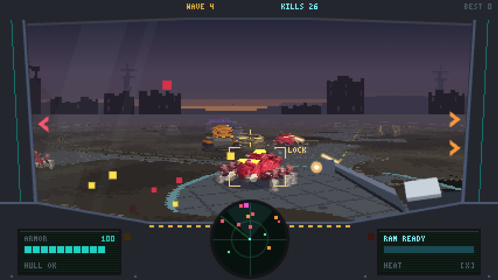
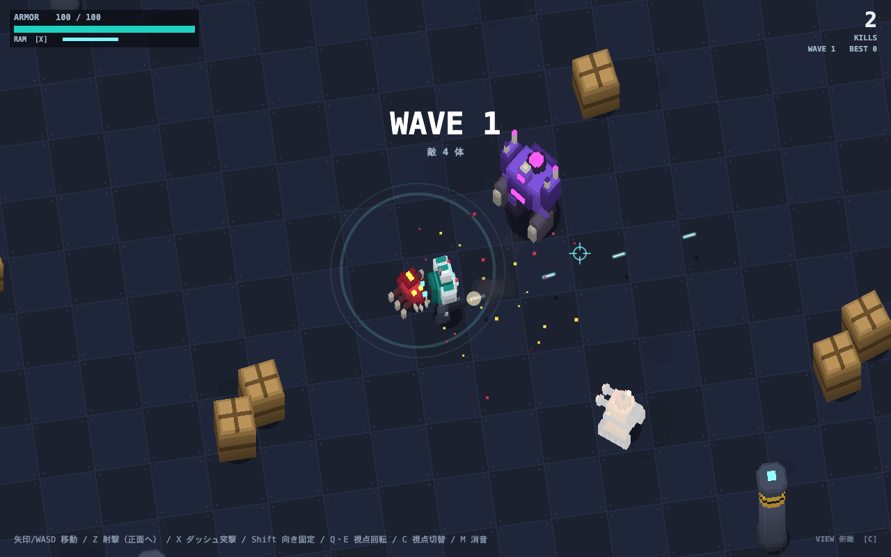
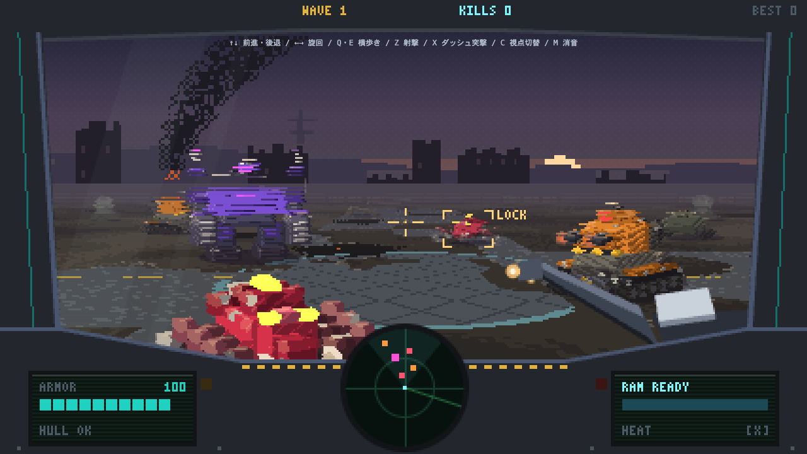
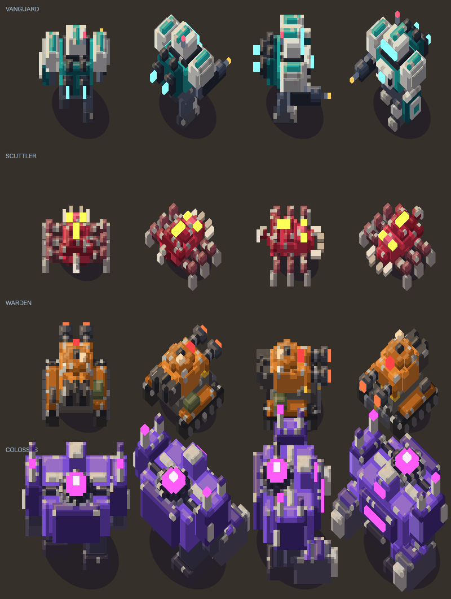
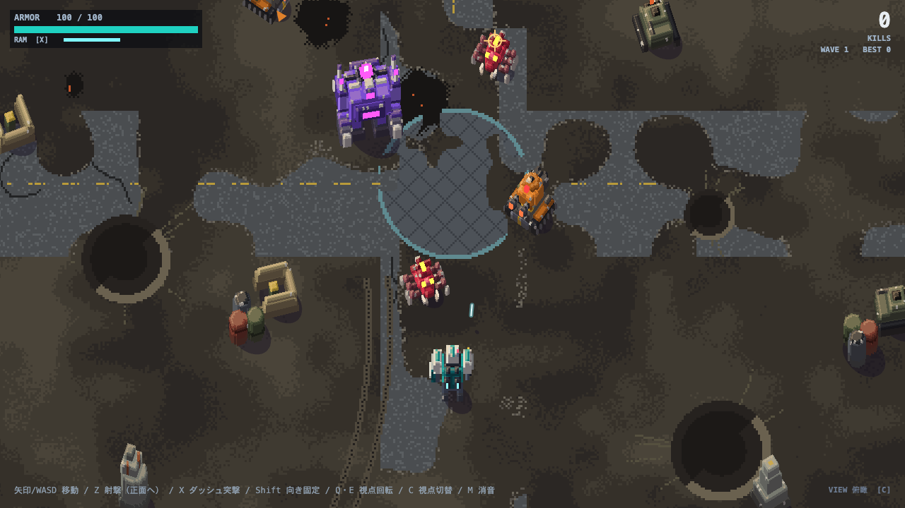

# STACKBOT ARENA

スプライトスタッキング（立体を「水平な断面の絵」の積み重ねで描く手法）で描いた、ブラウザで遊べるロボット対戦ゲームです。夕暮れの戦場が舞台で、俯瞰とコックピットからの一人称の 2 つの視点を切り替えられます。キーボードだけで遊びます。
自機のロボット VANGUARD を操作して、次々に現れる敵のロボットを撃ち倒していきます。



## 遊び方

ビルド不要です。リポジトリ直下で静的サーバーを立てて開きます。

```sh
python3 -m http.server 8765
# → http://localhost:8765/ を開く
```

`index.html` を直接ブラウザで開いても遊べます（外部のファイルや素材は読み込みません）。

### 操作（キーボードだけ）

| キー | 動作 |
| --- | --- |
| 矢印 / WASD | 移動（画面の向きが基準）。機体は進む方向を向く |
| Z（長押しで連射） | 射撃。機体の正面へ撃つ |
| X（Space でも可） | ダッシュ突撃 |
| Shift（押している間） | 向きを固定（横歩き・後退しながら撃つ） |
| Q / E | 視点を回す（コックピットでは横歩き） |
| C | 視点の切り替え（俯瞰 ⇔ コックピット）。選んだ視点はブラウザに保存 |
| M | 消音 |
| Enter | 開始 |
| R / Enter | ゲームオーバー後にリトライ |

マウスは使いません（タイトルの START ボタンはクリックでも押せます）。

#### 照準の決め方

- **向いている方向に撃つ**。照準は機体の正面で、画面には正面 200 先に水色の照準が出ます。
- 向きは「最後に進んだ方向」。撃ちたい方向へ一瞬キーを入れて向きを変え、Z を押し続ける。
- 敵から距離をとりながら撃ちたいときは **Shift で向きを固定**して後ろや横へ歩く。
- キーボードの 8 方向だけでは斜めの敵に当てにくいので、**正面 ±14°・距離 720 以内にいる敵のうち一番近い 1 体へ、弾を軽く吸い付かせる**（照準が黄色に変わってその敵に乗る）。範囲は狭いので、向きを合わせる操作は必要。

#### ダッシュ突撃（X）

- 向いている方向（移動キーを入れていればその方向）へ 0.22 秒、高速で突進する。突進中は**無敵**で、ぶつかった敵に 4 ダメージ（SCUTTLER は一撃）と強いノックバック。
- 突進のあと **1.1 秒のオーバーヒート**: 射撃もダッシュもできず、移動が遅くなり、機体から蒸気が出る。左上のゲージが `OVERHEAT` になり、空になると音が鳴って復帰。
- 強いが、外すと無防備な時間ができる、という縛り。

## ルール（最初の版）

- **目的**: できるだけ多くの敵ロボットを倒す。スコアは「倒した数」。
- **ウェーブ制**: 敵はウェーブごとにまとめて現れ、全滅させると次のウェーブ。ウェーブを重ねるほど数が増え、4 ウェーブごとに敵が硬くなる。出現する場所には赤い予告マークが出る。
- **装甲（HP）**: 100。敵の弾や体当たりで減る。ウェーブをクリアすると +15、緑の十字（回復アイテム、敵がときどき落とす）で +25。
- **終わり方**: 装甲が 0 になるとゲームオーバー。倒した数・到達ウェーブ・ベスト記録（ブラウザに保存）を表示し、RETRY / R / Enter で最初からやり直し。

### 敵

| 名前 | 見た目 | 動き |
| --- | --- | --- |
| SCUTTLER | 赤い低い多脚 | 速く、ジグザグに突っ込んできて体当たり |
| WARDEN | 橙の履帯砲台（ウェーブ 2〜） | 距離を保って横に動きながら 2 連砲を撃つ |
| COLOSSUS | 紫の大型（ウェーブ 3〜） | 硬い。足を止めて光った後、全方向に弾をばらまく |

## 視点（C で切り替え）

| 俯瞰 | コックピット（一人称） |
| --- | --- | --- |
|  |  |

- **俯瞰**: 真上寄りの視点。北が固定で、Q / E で回せる。移動は画面の向きが基準。
- **コックピット**: VANGUARD の頭の高さ（地面から 57）から前を見る一人称。操作は ↑↓ で前進・後退、←→ で旋回、Q / E で横歩き、Z / X は同じ。

### コックピット視点のしくみ



前の版で「正射影のスプライトスタッキングでは主観視点は成り立たない（遠近が付かない）」と確かめた（`docs/view-eye-experiment.png`）ので、一人称だけ別の描画（`src/fps.js`）にした。

1. **低解像度のバッファ**（画面の 1/3〜1/4、横 430〜480 画素）に描き、整数倍で拡大する。ドット絵の粒がそろい、1 画素ずつの計算も軽い。
2. **Mode 7 式の床**: 地平線より下の行ごとに「目の高さ ÷ 地平線からの行数」で距離を求め、その行の左端のワールド座標と 1 画素ぶんの差分から地面の絵を 1 画素ずつ引く。遠い行はミップマップ（1/2〜1/16 に縮めた絵）を使ってちらつきを抑え、距離で霞の色へ寄せる。
3. **距離で縮める断面スタック**: 物ごとに奥行き z を求め、拡大率 f / z で縮める。高さ h の断面は (目の高さ − h) / z の割合で縦につぶして、地平線から (目の高さ − h) × f / z の位置に置く。目より下の断面は下から、目より上の断面は上から目の高さへ向けて描く（見上げる部分は下面が手前に来る）。断面の絵は俯瞰と同じものをそのまま使い、遠い物は霞の色へ寄せた版をキャッシュする。物どうしは奥から手前へ並べて描く。
4. **空と遠景**: 夕暮れのグラデーション（ディザ入り）に、360° のパノラマ（丘・送電鉄塔・崩れた建物・クレーン・煙の柱）を機体の向きに合わせて横に流す。
5. **コックピット**: 上の梁（WAVE・KILLS）、画面の端に寄せた細い支柱、中央が低い U 字の計器盤。左に装甲の区切りゲージ、右にオーバーヒートと警告灯、中央に前が上のレーダー（視野の扇・走査線・敵の種類ごとの色の点）。照準は中央で、正面の吸い付き先がいると黄色の LOCK 枠で囲む。視野の外の敵は左右の端に矢印。右下に右腕のライフルが見え、撃つと反動で下がって銃口が光る。歩くと視界が上下し、突撃中は視野が広がって流れる線が出る。被弾で赤く光って画面が横にずれ、撃破されると砂嵐と SIGNAL LOST。文字は 3x5 のドットの字。

**限界**（いまの出来で目立つもの）:

- 断面 1 枚を 1 つのアフィン変換で描くので、遠近は物の中心の距離でしか付かない。すぐ近く（ロボット 1 体ぶん以内）の物は形がゆがみ、画面いっぱいの太い縞になる。
- 目の高さに近い断面は 1 画素の線になり、側面が横縞に見える（COLOSSUS の胴や、近くの柱で目立つ）。断面の積み重ねで側面を描く手法の限界。
- 目より上の部分は下から見上げた形になる。COLOSSUS の肩は下面の平らな板に見えやすい。
- 物どうしの前後は物の中心の奥行きだけで決めるので、大きな物が重なると前後を間違えることがある。
- 自機は見えない（右腕のライフルは 2D の絵）。弾は右腕の銃口から出るので、曳光弾は画面の右下から照準へ向かって飛ぶ。
- 地面の絵は ±1200 の範囲だけで、その外は同じ絵の繰り返し（霞で目立たないようにしている）。

性能: ヘッドレス Chrome・1920x1080 でデモを流して 60fps（最も遅いフレームで 23ms）。

## 見た目（3 版目）: 夕暮れの戦場



Fable（Claude のモデル）に 1 回相談した方針で作り直した。全体は「砲撃のあとの夕暮れ」: 地面は暗く彩度の低い土色、空は灰紫に細い残照、光は左上からの低い暖色、影は青紫。ロボットの光る色（水色・黄・橙赤・桃）と弾が背景の色と被らないようにしている。

**ドット絵の塗り**（`src/models.js` の断面生成）

- 明るさを −2〜+2 の 5 段に量子化し、影は青紫へ、光は暖色へ色相をずらす（前は連続的に暗くするだけで、ぼけたグラデーションに見えた）。
- 断面の絵を XY だけ 2 倍に細分化（1 ボクセル = 2x2 画素）。輪郭・部品の継ぎ目（パネルライン）を半ボクセルの細さで入れる。モデルの座標・層の数・当たり判定は同じ。
- 段差の付け根を 1 段暗く、左上からの光が当たる面を 1 段明るく（機体の向きに合わせて 8 方位の版をキャッシュ）。
- 足元は土色の汚れ、上面の角にときどき地金の傷、光る部品の隣は煤、大きな箱の上面の四隅にリベット。

**ロボット**（当たり判定・外形の範囲は変えていない）

| 名前 | 足したもの |
| --- | --- |
| VANGUARD | 首の暗い襟で頭を浮かせる、胸の吸気口、背中の放熱フィン、盾の白い上縁と紋章、ライフルの被筒、白いつま先。白を少し黄ばませ、青緑を暗くして白と分けた |
| SCUTTLER | 甲羅を 2 節に割る、頭の稜線、持ち上げた尾と針、立てた膝、暗い腹 |
| WARDEN | 前面のドーザー板、2 本の排気管、左右非対称の荷物（寝袋と工具箱）、砲身の放熱帯、砲塔の上の識別帯 |
| COLOSSUS | 炉の金属の縁と白い芯、骨色の襟板、炉から肩への配管、肩の前縁の明るい紫と骨色の角、籠手の上の帯 |

**フィールド**（`src/field.js`。1 テクセル = 1 ボクセル）



- 地面: 2 オクターブの値ノイズを 4 段に量子化した土、ひび割れた舗装の十字路（消えかけの中央線・縁の砂利）、轍、焼け跡（中心に残り火）、クレーター（放射状の筋）、夕空を映す水たまり、半分埋もれた鉄板の発進パッド。アリーナの外は霞の色へ寄せる。
- 外周: 壁をやめ、コンクリ障壁・黄黒の縞入り障壁・土嚢を 3 区間ずつ切り替えて並べ、四隅に監視塔の残骸。その外に当たり判定のない残骸を置き、一人称で地平線までの距離感を出す。
- 障害物: 柱と木箱を、竜の歯・折れたコンクリ柱（鉄筋つき）・土嚢の陣地・擱座した装甲車・ドラム缶に置き換えた（当たり半径は前と同じ 2 種類）。
- 影は右下へ伸ばした青紫の楕円。爆発に炎を足した。

前の版（2 版目）の比較は `docs/robots-before.png`（1 版目）と `docs/robots-after.png`（2 版目）。

## 音

外部の音源は使わず、Web Audio で合成する。前は高い矩形波の短い音（銃声は 900→420Hz・9ms）で軽かったので、重く無骨な方向に作り直した。

- 部品: 低い音の急降下（胴鳴り）、WaveShaper の歪み、帯域を絞ったノイズの破裂、手続きで作った 2.4 秒の残響（減衰するノイズのインパルス応答）、全体を締めるコンプレッサー。
- 銃声: 乾いた破裂 + 150→42Hz の胴鳴り + 短い残響。敵の砲はさらに低く、尾が長い。
- 爆発: 歪んだ 80→22Hz の轟き + 閉じていくノイズ + 散る破片の音 + 長い残響。COLOSSUS の全方位弾は地面を叩く衝撃。
- 突撃: 帯域が上がっていく噴射音と低い唸り、踏み切りの衝撃。ほかに被弾・オーバーヒートの蒸気・復帰の機械音・修理・ウェーブの警報を作り直し、自機の足音を足した。
- 確認: `?debug` で開き `__stack.sfxTest()` を呼ぶと、各音を OfflineAudioContext に書き出してピーク・鳴っている長さ・200Hz 未満の割合を返す。銃声は 200Hz 未満が 5%・9ms → 67%・433ms（余韻込み）、爆発は 79%・約 1.5 秒。

## しくみ

- `src/models.js` … ロボットや障害物を「箱」と「円柱」の部品で定義し、高さごとの断面画像（小さな canvas）をコードで生成する（塗りは上の「見た目」を参照）。歩行のコマは脚の位置を変えた別モデルとして作る。
- `src/field.js` … 戦場の地面・空の色・360° の遠景を手続きで作る。
- `src/game.js` … ゲームの進行と、俯瞰の描画。断面を下から順に、回転させつつ 1 枚ずつ上にずらして描く（スプライトスタッキング）。画面上の奥行き順に並べ替えて重ねる。効果音の合成もここ。
- `src/fps.js` … コックピット視点の描画（上の「コックピット視点のしくみ」）。
- 外部素材・ライブラリなし。

### 確認用 URL パラメータ（公開版にも残る。ブラウザ内だけで動き、害はない）

- `?demo` … 自動操縦のデモを流し続ける（タイトル画面の背景と同じ動き）。
- `?demo&warp=48` … 開始直後に 48 秒ぶん進めてから表示する（スクリーンショット用）。
- `?view=top|cockpit` … 最初の視点を選ぶ。
- `?scene` … 止まった確認用の場面（敵 5 体を自機の前に並べ、敵は動かず撃たない）。`&fire` で撃ち続ける。
- `?debug` … `window.__stack` から自機・敵などの状態を読めるようにする（ヘッドレス Chrome での動作確認用）。`__stack.sfxTest()` で音の測定。
